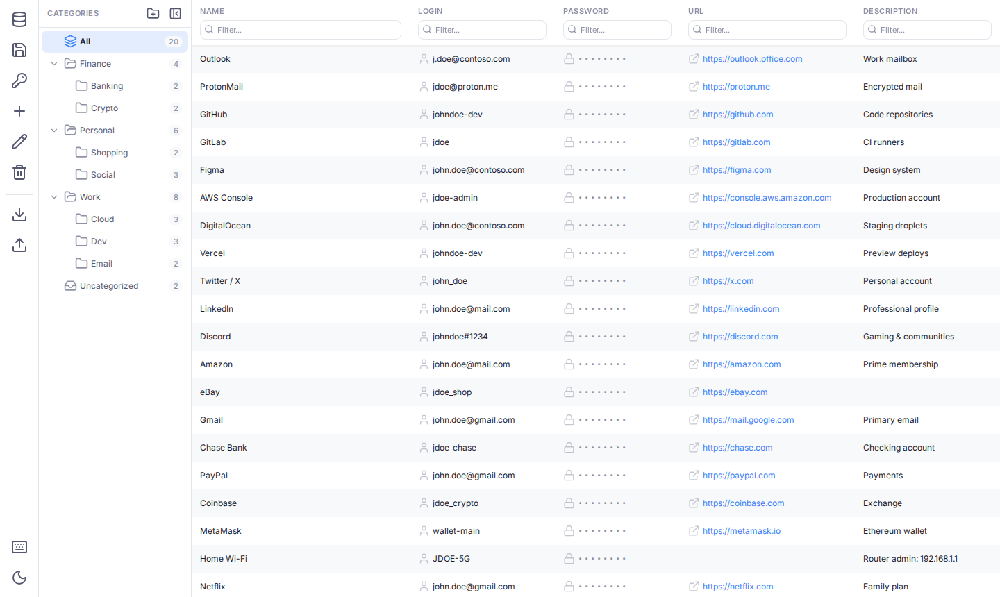
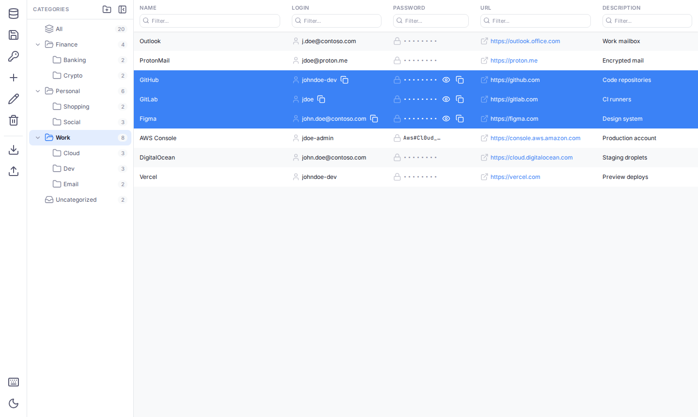
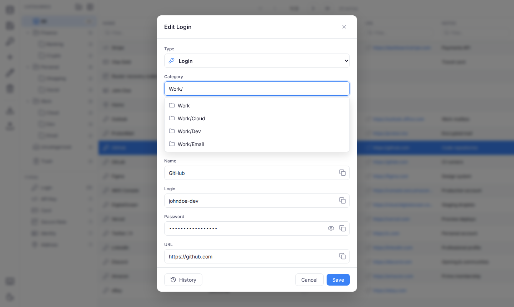
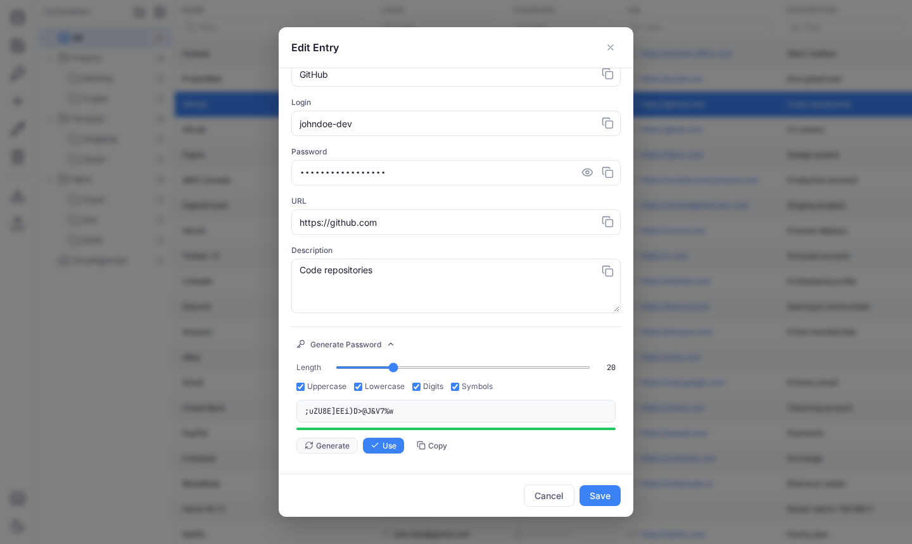
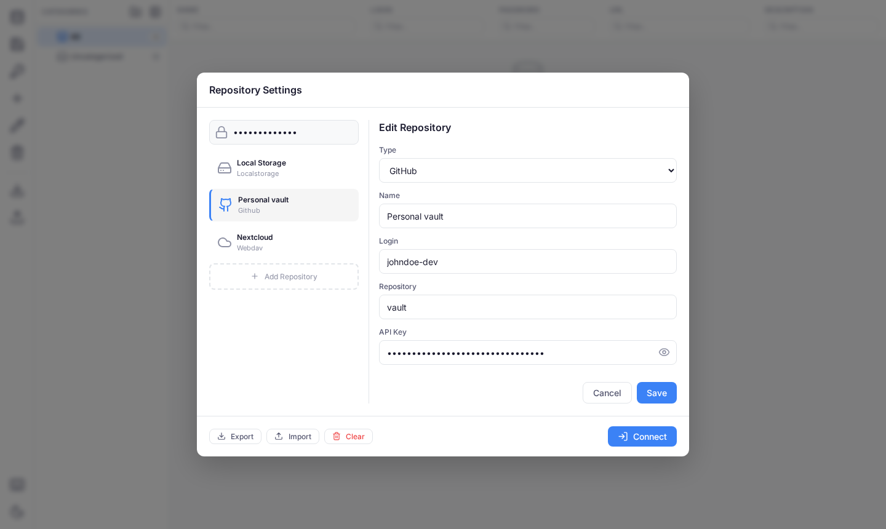
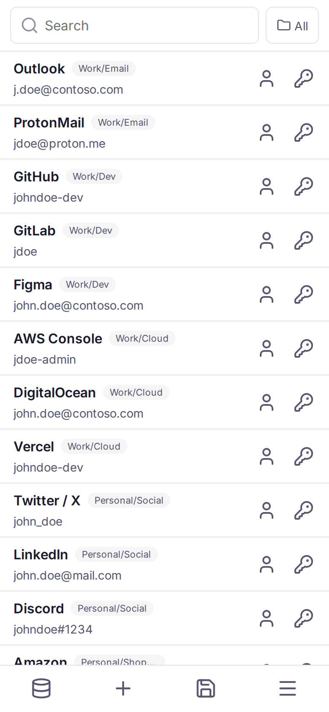
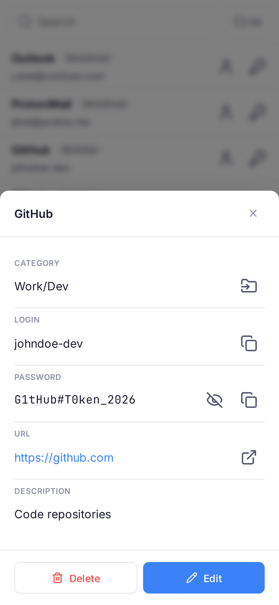
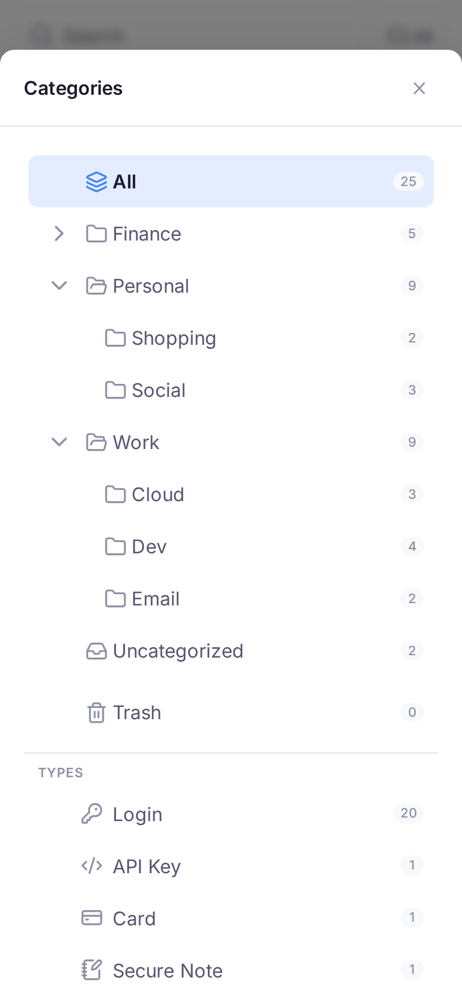

# Password Manager

A self-hosted, encrypted password manager built with Vue 3. Store your passwords securely in LocalStorage, GitHub, WebDAV, or Google Drive with zero-knowledge AES-256 encryption.



<table>
  <tr>
    <td width="50%"><br><sub>Category filter, multi-select, revealed password</sub></td>
    <td width="50%"><br><sub>Entry editor with category suggestions</sub></td>
  </tr>
  <tr>
    <td><br><sub>Password generator</sub></td>
    <td><br><sub>Repositories: LocalStorage, GitHub, WebDAV, Google Drive</sub></td>
  </tr>
</table>

<details>
<summary>📱 Mobile</summary>

<table>
  <tr>
    <td><br><sub>Entries with search</sub></td>
    <td><br><sub>Entry details</sub></td>
    <td><br><sub>Categories</sub></td>
  </tr>
</table>

</details>

Screenshots use fictional demo data and are regenerated with `npm run screenshots`.

## Features

- **AES-256-GCM encryption** — passwords encrypted client-side (Web Crypto API) with PBKDF2-SHA256 key derivation (600k iterations); tampering is detected
- **Multiple storage backends** — LocalStorage, GitHub repository, WebDAV server, or Google Drive (appDataFolder)
- **Multi-repo sync** — save to multiple repositories simultaneously
- **Safe sync between devices** — changes saved elsewhere in the meantime are merged, not overwritten
- **Local backups** — the last 10 versions of each repository's database are kept in the browser
- **Dark theme** — automatic system detection + manual toggle
- **PWA** — install as a native app on any device
- **Auto-lock** — automatic session lock after 5 minutes of inactivity
- **Password generator** — configurable length, character sets, strength indicator
- **Password masking** — passwords hidden in table, reveal on demand with auto-hide
- **Clipboard copy** — one-click copy for logins, passwords and any other field
- **Entry types** — logins, API keys, payment cards, secure notes, identities and addresses, each with its own fields; custom fields on any entry
- **Entry history** — previous values of every field (last 20 changes per entry), restore a whole version or a single field
- **Trash** — deleted entries can be restored for 30 days
- **Import/Export** — backup and restore your database as JSON
- **Keyboard shortcuts** — `Ctrl+S` save, `Ctrl+N` new login
- **Responsive design** — works on desktop, tablet, and mobile
- **URL sharing** — share repository config via URL parameters

## Tech Stack

- **Vue 3** + Composition API + `<script setup>`
- **Pinia** — state management (split stores: database + repos)
- **TypeScript** — strict mode across entire codebase
- **Vite 6** — fast builds with HMR
- **UnoCSS** — atomic CSS with custom design tokens
- **Lucide Icons** — clean, consistent icon set
- **Vitest** — 220 unit tests (crypto, stores, merge, backups, FileSystemDriver, Google Drive client, password strength)
- **Web Crypto API** — native browser encryption (AES-256-GCM + PBKDF2)
- **crypto-js** — only for reading legacy (v1/v2) database files

## Getting Started

### Prerequisites

- Node.js 18+
- npm 9+

### Install & Run

```bash
# Install dependencies
npm install

# Start development server
npm run dev

# Build for production
npm run build

# Run unit tests
npm run test

# Lint & format
npm run lint
npm run format
```

## Usage

### 1. Add a Repository

On first launch, the Repository Settings modal appears. Choose a storage backend:

| Backend | Description |
|---------|-------------|
| **LocalStorage** | Built-in, no setup needed. Data stored in browser. |
| **GitHub** | Store encrypted database in a GitHub repository. Requires a Personal Access Token with `repo` scope. |
| **WebDAV** | Store on any WebDAV server (Nextcloud, ownCloud, etc.) |
| **Google Drive** | Store in Google Drive's hidden appDataFolder. Requires an OAuth 2.0 Client ID. |

### 2. Set Master Password

Enter your master password in the Repository Settings modal. This password encrypts/decrypts your entire database. **It is never stored or transmitted.**

If the repository has no database yet, the app asks before creating one: type the master password again, and check the strength meter — a weak password gets a warning (anyone with a copy of the encrypted file can try passwords offline). The same meter is shown when you change the master password.

### 3. Connect & Manage

Click **Connect** to unlock the database. Then:

- **Add** — choose the type of the new entry (see [Entry types](#entry-types))
- **Edit** — double-click a row or select + Edit
- **Delete** — select rows + Delete; entries go to the trash (the toast has an **Undo** button)
- **Select several** — Ctrl/⌘+click toggles a row, Shift+click selects a range
- **Save** — persist changes to the repository
- **Filter** — type in any column header to filter entries
- **Copy** — click the copy icon in the Details and Secret cells or next to any field in the form (the clipboard is cleared after 30 s)

### Entry types

Every entry has a type that decides its fields. The table shows all types in the same columns: **Name** (with the type icon), **Details** (a summary: the login, `Visa •••• 4242 · 12/27`, `production · until 01/31/2027`, a city…), **Secret** (the main secret, masked, with show and copy buttons), **URL** and **Notes**.

| Type | Fields (🔒 masked) | Secret column |
|------|--------------------|---------------|
| Login | Login, Password 🔒, URL, Notes | Password |
| API Key | Key 🔒, Secret 🔒, Environment, Scopes, Expires, Console URL, Notes | Key |
| Card | Cardholder, Number 🔒, Expiry, CVV 🔒, PIN 🔒, Bank, Bank phone, Notes | Number |
| Secure Note | Note 🔒 (multi-line) | Note |
| Identity | Full name, Date of birth, Phone, Email, Company, Job title, Notes | — |
| Address | Country, Region, City, Street, Building / apartment, Postal code, Notes | — |

- Card numbers are grouped as you type, the card brand is detected and a typo in the number (Luhn checksum) is pointed out; the expiry date is formatted as MM/YY
- **Custom fields** — **Add field** in the form adds a field to one entry: give it a name and a kind (text, secret, multi-line text, URL, email, phone, date); fields can be reordered and removed
- **Changing the type** of an entry keeps the fields both types have; the others become custom fields, so nothing is lost
- **Types** below the category tree (and in the category picker on a phone) filter the list by type, together with the selected category; with a type selected, **Add** creates an entry of that type
- Search, history, the trash and merging changes from other devices work with all fields, custom ones included

### Categories

The panel on the left shows categories as a tree with entry counts (a category's count includes its subcategories):

- **Filter** — click a category (or **All** / **Uncategorized**) to show its entries, incl. subcategories
- **Select several** — Ctrl/⌘+click adds or removes a category, Shift+click selects a range; the table shows entries of all selected categories. Dragging or deleting one of the selected categories applies to all of them
- **Create / rename / delete** — the folder button in the panel header, or the buttons that appear on hover. Deleting a category moves its entries and subcategories one level up; no entries are deleted
- **Move entries** — drag one or several selected rows onto a category (or onto **Uncategorized**)
- **Move categories** — drag a category onto another one, or onto **All** to move it to the top level
- **In the entry form** — type a path like `Work/Email`; existing categories are suggested, a new path creates the category
- The panel can be collapsed and resized; the selected category and expanded folders are remembered in the browser

Categories are stored as paths in the `category` field of each entry, so databases from older versions keep their categories as top-level ones.

### History

Every time an entry is saved with changes, the previous values of the changed fields are kept (the last 20 versions per entry; moving to another category is not recorded). Open it with **History** in the entry form, in the row's context menu, or in the entry details on a phone:

- Old passwords are masked, with buttons to reveal and copy them
- **Restore** brings back a whole version or a single field; the restore itself is recorded, so it can be undone too. In the entry form, restoring fills the form and is stored on **Save**
- **Clear history** removes the previous values for good — e.g. after a password leaked

### Trash

Deleted entries go to **Trash** at the bottom of the category tree (drag rows onto it to delete them). Entries keep their category and history there and are deleted for good 30 days after deletion.

- **Restore** — right-click an entry in the trash (or open it on a phone); it returns to its category
- **Delete forever** — the context menu or the Delete key, with confirmation
- **Empty trash** — the button above the list

### On a phone

Below 768 px the app switches to a mobile layout:

- **Search** — one field at the top searches all fields; the button next to it picks a category
- **Entries** — a scrolling list of cards; the buttons on a card copy the login / password
- **Details** — tap a card to see all fields, reveal or copy the password, open the URL, move it to another category, see its **History**, **Edit** or **Delete**
- **Trash** — in the category picker; open a deleted entry to **Restore** it or delete it forever
- **Bottom bar** — Repository · Add · Save · **More** (export, import, change master password, theme, lock)

## Sync & Backups

**Several devices.** The app remembers which version of the database file it loaded (GitHub blob SHA, Google Drive file version, or a hash of the content for WebDAV and Local Storage). On **Save** it checks that the file was not changed in the meantime. If it was — e.g. you saved on your phone while the laptop had the database open — the two versions are merged instead of overwriting each other:

- entries added, edited, moved to the trash or deleted on either side are all kept
- if the same field was changed on both sides, your value wins and the other one is added to the entry's **History**
- the toast tells what came from the other side

If the other version was saved with a different master password, it can't be merged: the app asks whether to overwrite it (it is kept as a local backup) or to cancel and reconnect with that password. The extra repositories a database is copied to (e.g. Local Storage next to GitHub) are always overwritten.

**Local backups.** Before the database in a repository is overwritten, the previous version is kept in the browser's IndexedDB — the last 10 per repository, still encrypted. Select a repository and press **Backups** at the bottom of the repository window (or **Open a backup** when loading fails); **Restore** loads a backup as unsaved changes, **Save** stores it.

**Access errors.** A rejected GitHub token, missing repository permissions, a rate limit, a wrong WebDAV password or a denied Google Drive grant are reported in plain words, with what to fix. Spaces pasted around tokens, logins and URLs are removed.

## Security

| Aspect | Implementation |
|--------|---------------|
| Encryption | AES-256-GCM (Web Crypto API) — authenticated: a wrong password or a modified file is always rejected |
| Key Derivation | PBKDF2-HMAC-SHA256, 600,000 iterations, random 128-bit salt, random 96-bit IV per save |
| Zero Knowledge | Master password never leaves the browser |
| Auto-lock | After 5 min inactivity unsaved changes are saved, then the master password and all decrypted data are wiped from memory |
| Legacy Support | Older files (v2: AES-256-CBC via crypto-js, v1: 3DES) are read automatically and re-encrypted as v3 on the next save |
| Google Drive | Data stored in appDataFolder — only this app can access the files |
| Repository secrets | API keys / WebDAV passwords are stored **unencrypted** in the browser's localStorage and in exported repository files |

The app must be served over **HTTPS** (or `localhost`): the Web Crypto API is not available on plain HTTP.

### Database file format

| Version | Cipher | Key derivation | Status |
|---------|--------|----------------|--------|
| v4 | Same as v3 | Same as v3 | Current — written on every save; marks databases with entry types |
| v3 | AES-256-GCM (Web Crypto) | PBKDF2-SHA256, 600k iterations (stored in file) | Read-only |
| v2 | AES-256-CBC, no MAC (crypto-js) | PBKDF2-SHA256 or SHA1, 100k iterations | Read-only |
| v1 | 3DES (crypto-js) | Password used as passphrase | Read-only |

> **Upgrading:** once a database is saved in v4 (v3), versions of the app released before entry types (before v3 support)
> cannot open it — they report "Incorrect password", which also keeps them from overwriting it. Reload the app on every
> device so the service worker picks up the new version. **A tab that was already open with an old version can still
> save over the database and drop types and custom fields — reload it before saving.** A file from a newer version than
> the app is refused with "saved by a newer version of the app".

## Google Drive Setup

To use Google Drive as a storage backend:

1. Go to [Google Cloud Console](https://console.cloud.google.com/)
2. Create a new project (or select an existing one)
3. Enable the **Google Drive API** in **APIs & Services → Library**
4. Go to **APIs & Services → Credentials** → **Create Credentials → OAuth Client ID**
5. Select **Web application** as the application type
6. Add your app's URL to **Authorized JavaScript origins** (e.g. `http://localhost:5173` for development, `https://yourdomain.com` for production)
7. Copy the **Client ID** (format: `123456789.apps.googleusercontent.com`)
8. In the app, create a new repository with type **Google Drive** and paste the Client ID
9. On first connect, a Google OAuth popup will appear — grant access to the app data folder

> **Note:** The app only requests the `drive.appdata` scope, which limits access to a hidden app-specific folder. Your other Google Drive files are never accessible to this app.

## Deployment

### GitHub Pages

The GitHub Actions workflow (`.github/workflows/deploy.yml`) runs lint, type-check, unit and E2E tests, then builds and deploys to GitHub Pages on every push to `main`. The build output is not committed — in the repository settings, **Pages → Source** must be set to **GitHub Actions**.

### Self-Hosted

```bash
npm run build
# Serve the `dist/` directory with any static file server (HTTPS required)
```

## Project Structure

```
src/
├── main.ts                    # App entry point
├── App.vue                    # Main layout: data table, keyboard shortcuts, auto-lock
├── components/
│   ├── AppSidebar.vue         # Desktop sidebar menu
│   ├── BottomNav.vue          # Mobile bottom navigation
│   ├── BaseModal.vue          # Reusable modal with focus trap
│   ├── CategoryInput.vue      # Category field with suggestions
│   ├── CategoryPanel.vue      # Desktop: collapsible, resizable category panel
│   ├── CategoryPickerSheet.vue    # Mobile: pick a category (filter / move)
│   ├── CategoryTree.vue       # Category tree with counts and drag & drop
│   ├── ChangePasswordModal.vue    # Change master password
│   ├── ConfirmDialog.vue      # Confirmation dialog (replaces confirm())
│   ├── EntryCardList.vue      # Mobile: list of entry cards
│   ├── EntryContextMenu.vue   # Right-click menu for table rows
│   ├── EntryDetailsSheet.vue  # Mobile: entry details / edit / delete
│   ├── EntryEditModal.vue     # Entry editor
│   ├── EntryFormFields.vue    # Dynamic form renderer
│   ├── FormField.vue          # Individual form field
│   ├── KeyboardShortcutsModal.vue # Shortcuts help
│   ├── LoaderOverlay.vue      # Loading overlay
│   ├── MobileMenuSheet.vue    # Mobile: "More" menu
│   ├── NotificationToast.vue  # Toast notification system
│   ├── PasswordGenerator.vue  # Password generator panel
│   └── RepoSettingsModal.vue  # Repository settings (split-view)
├── composables/
│   ├── useCategoryState.ts    # Selected / expanded categories, panel size (per browser)
│   ├── useConfirm.ts          # Confirmation dialog via provide/inject
│   ├── useMediaQuery.ts       # Reactive media query (mobile layout switch)
│   └── useNotify.ts           # Toast notifications via provide/inject
├── services/
│   ├── FileSystemDriver.ts    # GitHub/WebDAV/LocalStorage/Google Drive adapters
│   └── googleDrive.ts         # GIS auth + Drive REST API (no gapi/SDK)
├── stores/
│   ├── database.ts            # Database state + CRUD operations
│   └── repos.ts               # Repository management
├── types/
│   └── menu.ts                # Sidebar / bottom nav actions
├── utils/
│   ├── categories.ts          # Category paths and tree building
│   ├── clipboard.ts           # Copy secrets, auto-clear the clipboard
│   ├── crypto.ts              # AES-256-GCM encryption (reads legacy v1/v2 formats)
│   ├── debounce.ts
│   └── download.ts            # Save JSON as a file
├── styles/
│   ├── tokens.css             # Design tokens (colors, spacing, etc.)
│   ├── base.css               # Global reset + typography
│   ├── components.css         # Shared buttons, form fields, animations
│   └── main.css               # Style entry point
└── __tests__/                 # Unit tests (mirror src/ layout)
```

## License

MIT

